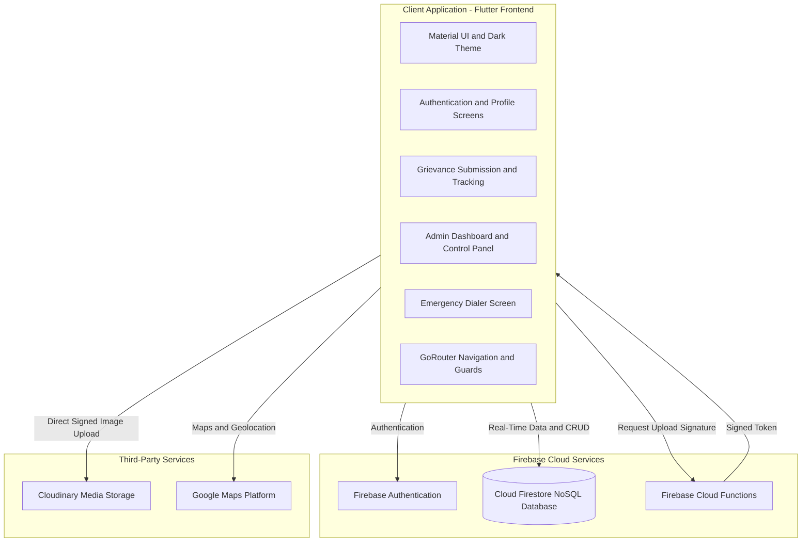

# 🏛️ CivicEase - Civic Grievance Redressal & Municipal Management Platform

[](https://flutter.dev/)
[](https://firebase.google.com/)
[](https://cloudinary.com/)
[](https://developers.google.com/maps)
[](https://opensource.org/licenses/MIT)

**CivicEase** is a modern, cross-platform civic issue reporting and municipal grievance management application built using Flutter and Firebase. It connects citizens with municipal authorities by allowing users to report local infrastructure problems, attach photographic evidence, and track complaint resolution in real time. Municipal administrators can manage grievances, monitor complaint statistics, and update resolution progress through a dedicated dashboard.

---

## 📌 Table of Contents

- [Key Features](#-key-features)
  - [Citizen Capabilities](#1-citizen-capabilities)
  - [Municipal Authority and Admin Capabilities](#2-municipal-authority-and-admin-capabilities)
  - [Emergency Response System](#3-emergency-response-system)
- [System Architecture and Technology Stack](#-system-architecture-and-technology-stack)
- [Project Directory Structure](#-project-directory-structure)
- [Database Schema](#-database-schema-firestore)
- [Cloud Functions and Cloudinary Integration](#-cloud-functions-and-cloudinary-integration)
- [Getting Started](#-getting-started-and-installation)
  - [Prerequisites](#prerequisites)
  - [Installation](#step-1-clone-and-install-dependencies)
  - [Firebase Setup](#step-2-firebase-setup)
  - [Cloud Functions Setup](#step-3-cloud-functions-setup)
  - [Running the Application](#step-4-run-the-app)
- [Routes and Navigation Flow](#-routes-and-navigation-flow)
- [UI and Theming System](#-ui-and-theming-system)
- [Contributing](#-contributing)
- [License](#-license)

---

## 🌟 Key Features

### 1. Citizen Capabilities

- **Flexible Authentication:** Secure registration and sign-in using Email/Password and Google Sign-In through Firebase Authentication.
- **Grievance Filing:**
  - Submit complaints across major civic categories: **Water, Electrical, Roads, and Sanitation**.
  - Provide complaint titles, location addresses, and detailed descriptions.
  - **Anonymous Reporting:** Submit grievances anonymously while allowing authorities to investigate and resolve reported issues.
  - Capture geographical coordinates using `geolocator` and `google_maps_flutter`.
  - Attach photographic evidence using image capture or gallery selection.
  - Upload images through Cloudinary integration.
- **Real-Time Status Tracking:**
  - Track complaints through the `Pending`, `In Progress`, and `Resolved` stages.
  - View complaint details, progress notes, and geographical information.
- **Categorical Browsing and Filtering:**
  - View category-wise complaint counts and issue summaries.
  - Search complaints using keywords.
  - Filter complaints by date, category, and resolution status.
- **Profile and Account Management:**
  - View and edit user profile information.
  - Update contact numbers and account passwords.

### 2. Municipal Authority and Admin Capabilities

- **Role-Based Access Control (RBAC):** Administrative access is controlled through the `users.isAdmin` attribute in Firestore.
- **Administrative Analytics Dashboard:**
  - Display statistics for Total, Pending, In Progress, and Resolved grievances.
  - Display a system-wide administrative announcement or bulletin board note.
  - Synchronize dashboard information using Firestore.
- **Complaint Triage and Resolution Management:**
  - Update complaint statuses between `Pending`, `In Progress`, and `Resolved`.
  - Add progress notes to individual complaints.
  - View complaint locations through integrated Google Maps.
  - Access photographic evidence submitted with grievances.
  - View reporter information according to administrative permissions.

### 3. Emergency Response System

- **One-Tap Emergency Calling:** Direct phone launcher integration using `url_launcher` for important Indian public service contacts.

| Emergency Service | Contact Number |
|---|---:|
| 🚓 Police | `100` |
| 🚑 Ambulance | `108` |
| 🚒 Fire Brigade | `101` |
| 👩 Women Helpline | `1091` |
| 🧒 Child Helpline | `1098` |
| 👴 Senior Citizen Helpline | `14567` |
| ⚖️ Anti-Corruption Helpline | `1031` |
| 🚆 Railway Enquiry | `139` |

- **Emergency Safety Tips:** Provides useful emergency guidelines and situational response instructions within the application.

---

## 🛠️ System Architecture and Technology Stack

The application follows a Flutter-based client architecture supported by Firebase backend services and third-party integrations.



### Core Technologies

| Layer | Technology | Purpose |
|---|---|---|
| **Frontend Framework** | Flutter 3.x / Dart 3.x | Cross-platform application development |
| **Navigation** | GoRouter | Application routing and route guards |
| **Authentication** | Firebase Auth and Google Sign-In | User registration and authentication |
| **Database** | Cloud Firestore | Real-time storage of grievances and user information |
| **Backend** | Firebase Cloud Functions | Server-side processing and Cloudinary signature generation |
| **Media Storage** | Cloudinary API | Image uploads and cloud media storage |
| **Maps and Location** | Google Maps Flutter and Geolocator | Maps, location capture, and geolocation |
| **Styling** | Google Fonts (Poppins) | Application typography and visual design |
| **Local Storage** | SharedPreferences | Local preference and credential-related data storage |

---

## 📁 Project Directory Structure

```text
CivicEase/
│
├── android/                         # Android native configurations
├── assets/                          # Static assets and graphics
│   ├── app_icon.png                 # Application launcher icon
│   └── images/
│       └── logo.png                 # CivicEase branding
│
├── functions/                       # Firebase Cloud Functions
│   ├── index.js                     # Cloudinary signature generation
│   ├── package.json                 # Backend dependencies
│   └── package-lock.json
│
├── ios/                             # iOS native configurations
│
├── lib/                             # Main Dart application code
│   ├── firebase_options.dart        # Firebase platform configuration
│   ├── main.dart                    # Application entry point
│   ├── theme.dart                   # Application theme and styling
│   ├── web_url_strategy.dart        # Web URL strategy
│   ├── web_url_strategy_stub.dart   # Non-web URL strategy stub
│   │
│   ├── screens/                     # Application screens
│   │   ├── welcome_screen.dart
│   │   ├── login_screen.dart
│   │   ├── register_screen.dart
│   │   ├── home_screen.dart
│   │   ├── category_screen.dart
│   │   ├── complaint_screen.dart
│   │   ├── complaint_detail_screen.dart
│   │   ├── add_complaint_screen.dart
│   │   ├── tracking_screen.dart
│   │   ├── emergency_screen.dart
│   │   ├── profile_screen.dart
│   │   ├── edit_profile_screen.dart
│   │   ├── change_password_screen.dart
│   │   ├── admin_dashboard_screen.dart
│   │   └── admin_panel_screen.dart
│   │
│   └── widgets/                     # Reusable UI components
│       ├── app_bottom_nav_bar.dart
│       ├── custom_text_field.dart
│       └── rounded_button.dart
│
├── firebase.json                    # Firebase configuration
├── pubspec.yaml                     # Flutter dependencies
└── README.md                        # Project documentation
```

---

## 🗄️ Database Schema (Firestore)

CivicEase uses Cloud Firestore to store user information, civic grievances, and administrative announcements.

### 1. `users` Collection

Stores registered user information and administrative privileges.

```json
{
  "uid": "FIREBASE_AUTH_UID",
  "name": "Jane Citizen",
  "email": "jane@example.com",
  "number": "+91 9876543210",
  "isAdmin": false,
  "createdAt": "Timestamp"
}
```

### 2. `grievances` Collection

Stores civic complaints submitted through the application.

```json
{
  "title": "Broken Water Pipeline causing leakage",
  "category": "Water",
  "description": "Continuous water outflow near Main Cross Street.",
  "address": "45 Park Avenue, Ward 12",
  "location": "GeoPoint(18.5204, 73.8567)",
  "photoUrl": "CLOUDINARY_IMAGE_URL",
  "userId": "FIREBASE_AUTH_UID",
  "userName": "Jane Citizen",
  "isAnonymous": false,
  "status": "Pending",
  "progressNote": "Municipal crew dispatched for site inspection.",
  "createdAt": "Timestamp"
}
```

### 3. `admin_dashboard` Collection

Stores administrative announcements and dashboard information.

**Document:** `admin_dashboard/note`

```json
{
  "text": "Monsoon preparedness review scheduled for this Friday across all sectors."
}
```

---

## ☁️ Cloud Functions and Cloudinary Integration

CivicEase uses Firebase Cloud Functions to support secure image uploads through Cloudinary.

Instead of exposing the Cloudinary API secret directly in the Flutter application, the backend generates an upload signature.

### Upload Workflow

1. **Client Request:** The Flutter application invokes `getCloudinarySignature` using the Firebase Functions SDK.
2. **Authentication:** The Cloud Function validates the authenticated user.
3. **Signature Generation:** The function generates a timestamped upload signature using the Cloudinary API secret.
4. **Signature Response:** The function returns the required upload information, including the signature, timestamp, API key, and cloud name.
5. **Image Upload:** The Flutter application uploads the image directly to Cloudinary using the generated signature.
6. **Database Storage:** The resulting Cloudinary image URL is stored in the corresponding Firestore grievance document.

The upload process helps keep the Cloudinary API secret on the server side rather than exposing it in the client application.

---

## 🚀 Getting Started and Installation

Follow these steps to set up and run CivicEase locally.

### Prerequisites

Before installing the project, ensure you have:

- [Flutter SDK](https://docs.flutter.dev/get-started/install) (version 3.0.0 or higher)
- [Dart SDK](https://dart.dev/get-dart)
- [Node.js](https://nodejs.org/) (version 18 or 20) and npm
- [Firebase CLI](https://firebase.google.com/docs/cli)
- Android device or emulator, or Chrome for Web testing
- Google Maps API key for map-related functionality
- Firebase project with the required services enabled

### Step 1: Clone and Install Dependencies

Clone the repository:

```bash
git clone https://github.com/sohamvilankar23-commits/CivicEase.git
```

Navigate to the project directory:

```bash
cd CivicEase
```

Install Flutter dependencies:

```bash
flutter pub get
```

### Step 2: Firebase Setup

1. Log in to Firebase:

```bash
firebase login
```

2. Configure FlutterFire:

```bash
flutterfire configure
```

3. Select your Firebase project. This generates or updates the Firebase platform configuration files.

4. Enable the required services in the [Firebase Console](https://console.firebase.google.com/):

   - **Firebase Authentication:** Enable Email/Password and Google Sign-In providers.
   - **Cloud Firestore:** Create and configure your Firestore database.
   - **Firebase Cloud Functions:** Enable the service if using the Cloudinary signature function.

5. Configure Firestore Security Rules according to your application's authentication and authorization requirements.

**Important:** Do not use unrestricted authenticated-user write permissions in a production deployment. Rules should restrict users to their own records and allow administrative operations only for verified administrators.

### Step 3: Cloud Functions Setup

Navigate to the Cloud Functions directory:

```bash
cd functions
```

Install backend dependencies:

```bash
npm install
```

Configure the required Cloudinary credentials securely using Firebase-supported secret management.

The following values are required:

```text
CLOUDINARY_API_KEY
CLOUDINARY_API_SECRET
CLOUDINARY_CLOUD_NAME
```

Do not commit actual API secrets or private credentials to GitHub.

Deploy the Cloud Functions:

```bash
firebase deploy --only functions
```

Return to the project root:

```bash
cd ..
```

### Step 4: Run the App

**Android**

Connect an Android device or start an emulator:

```bash
flutter run -d android
```

**Web**

Run the application using Chrome:

```bash
flutter run -d chrome
```

**Windows Desktop**

```bash
flutter run -d windows
```

---

## 🧭 Routes and Navigation Flow

CivicEase uses **GoRouter** for navigation between application screens.

The main navigation structure includes:

```text
/welcome
    ├── /login
    └── /register

/home
    ├── /category/:id
    ├── /complaint
    ├── /add-complaint
    ├── /tracking
    ├── /emergency
    ├── /profile
    │     ├── /edit-profile
    │     └── /change-password
    ├── /admin-panel
    └── /admin-dashboard
```

The application uses authentication and route-guard logic to control access to relevant screens.

---

## 🎨 UI and Theming System

CivicEase uses a modern dark-themed interface designed to provide a consistent and accessible user experience.

The application's theme is configured in [`lib/theme.dart`](lib/theme.dart).

### Design Elements

- **Primary Color:** `#1E3A8A` - Deep Blue
- **Secondary Color:** `#1F2937` - Dark Slate Gray
- **Accent Color:** `#F59E0B` - Amber
- **Card Colors:** `#374151` and `#2A2A2A`
- **Typography:** Google Fonts Poppins

The interface uses reusable widgets, consistent typography, and a unified color palette across application screens.

---

## 🤝 Contributing

Contributions and suggestions are welcome.

To contribute:

1. Fork the repository.
2. Create a feature branch:

```bash
git checkout -b feature/NewCivicFeature
```

3. Commit your changes:

```bash
git commit -m "feat: Add new municipal feature"
```

4. Push your branch:

```bash
git push origin feature/NewCivicFeature
```

5. Open a Pull Request.

---

## 📄 License

This project is licensed under the [MIT License](LICENSE).